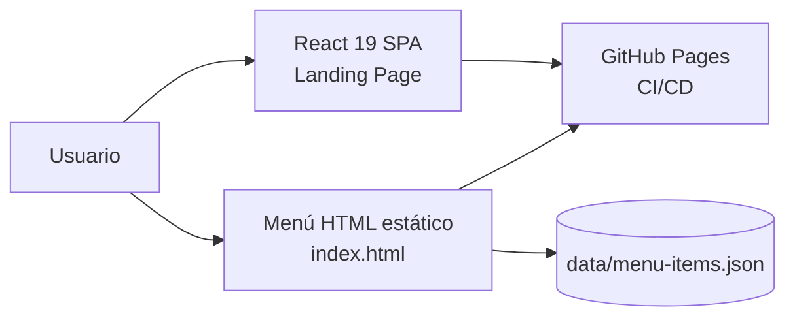
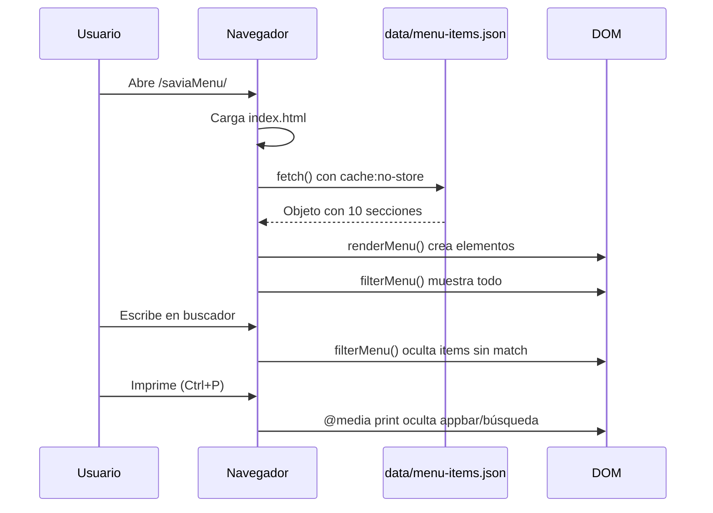

# SAVIA · Menú Digital

Menú digital interactivo y sitio web para **SAVIA** (*"Alimenta lo que eres"*), un emprendimiento de alimentación saludable ubicado en Pasto, Nariño, frente a la Universidad Mariana. El proyecto combina una landing page institucional construida con React + TypeScript + Tailwind CSS, y un menú interactivo en HTML estático que carga los productos desde un archivo JSON con búsqueda en vivo, diseño responsivo y soporte para impresión.

---

## Estado del proyecto

| Componente | Estado |
|------------|--------|
| **Landing page React** (Hero, Productos, Nosotros, Contacto) | ✅ Funcional, pendiente contenido real |
| **Menú digital interactivo** (`index.html`) | ✅ En producción, datos reales de SAVIA |
| **Catálogo de productos** (`data/menu-items.json`) | ✅ 43 items reales en 10 categorías |
| **Búsqueda en vivo** (filtro por nombre/descripción) | ✅ Implementada |
| **Diseño responsivo** (Desktop / Tablet / Mobile) | ✅ Media queries para 1024px y 640px |
| **Impresión** (estilo print sin appbar/búsqueda) | ✅ `@media print` |
| **GitHub Pages** (CI/CD automático) | ✅ Deploy automático en cada push a `main` |
| **Fuente personalizada** (Lobster para mensaje institucional) | ✅ Cargada desde `/fuentes/lobster/` |

---

## Captura rápida

El menú muestra los productos de SAVIA organizados en dos columnas:

| Columna izquierda (fondo oscuro) | Columna derecha (fondo beige) |
|:---|---:|
| 🥪 Sandwiches (5 opciones) | 🥣 Bowls Frutales (personalizables) |
| 🥗 Bowls Salados 26 oz ($16.000) | 🥤 Batidos Refrescantes |
| ☕ Bebidas Calientes | 💪 Batidos Funcionales |
| 🧆 Acompañamientos | ⭐ Batidos Especiales |
| | 🧊 Bebidas Frías |
| | 📌 Mensaje institucional |

Cada sección incluye precios en pesos colombianos, descripciones, y opciones personalizables con costos adicionales.

---

## Arquitectura



El proyecto tiene dos caras que conviven en el mismo repositorio pero tienen propósitos diferentes:

1. **Landing Page (React + TypeScript + Vite):** Una SPA con secciones Hero, Productos, Nosotros y Contacto. Construida con componentes funcionales y Tailwind CSS. Es una plantilla institucional que actualmente muestra datos de demostración.

2. **Menú Digital (HTML + CSS + JavaScript vanilla):** La pieza funcional y en producción. Es un HTML estático con estilo propio que carga `data/menu-items.json` mediante `fetch`, renderiza cada sección del menú, y permite búsqueda en vivo. No depende de React ni del build de Vite — se sirve directamente desde GitHub Pages.

Ambos conviven bajo el mismo dominio porque `vite.config.ts` define `base: '/saviaMenu/'` y el HTML estático está en la raíz del repositorio, que es lo que GitHub Pages sirve por defecto.



---

## Stack tecnológico

| Capa | Tecnología | Justificación |
|------|-----------|---------------|
| **Framework UI** | React 19 + TypeScript 5.8 | Componentes reutilizables con tipado estricto (`strict: true` en tsconfig) |
| **Build tool** | Vite 7 | HMR ultrarrápido, build optimizado para producción |
| **Estilos SPA** | Tailwind CSS 4 | Utilidades primero, diseño responsivo rápido |
| **Estilos menú** | CSS nativo + `color-mix()` + `clamp()` | Sin dependencias, diseño visual único con variables CSS |
| **Datos** | JSON plano (`data/menu-items.json`) | Sin backend, editable directamente, cacheable con `no-store` |
| **Fuente** | Lobster 1.4 (OTF local) | Para el mensaje institucional con estilo artesanal |
| **CI/CD** | GitHub Pages + GitHub Actions | Deploy automático por push a `main` |
| **Linting** | ESLint 9 + `typescript-eslint` + `react-hooks` | Cobertura completa de reglas para TypeScript + React |

### Dependencias clave

```json
{
  "dependencies": {
    "react": "^19.1.1",
    "react-dom": "^19.1.1"
  },
  "devDependencies": {
    "@vitejs/plugin-react": "^5.0.0",
    "tailwindcss": "^4.1.12",
    "typescript": "~5.8.3",
    "vite": "^7.1.2"
  }
}
```

Sin runtime JavaScript más allá de React para la landing page. El menú funciona con JavaScript vanilla (< 200 líneas).

---

## Estructura del repositorio

```text
saviaMenu/
├── index.html                  ← Menú digital (producción real)
├── malo.html                   ← ✗ Reliquia del scaffold Vite (no usado)
│
├── src/                        ← Landing page React
│   ├── main.tsx                ← Entry point React
│   ├── App.tsx                 ← Layout principal (Header + Hero + ...)
│   ├── index.css               ← Tailwind directives + estilos base
│   ├── App.css                 ← ✗ Vacío (migrado a Tailwind)
│   ├── vite-env.d.ts           ← Tipos Vite
│   │
│   ├── components/
│   │   ├── Header.tsx          ← Navbar con navegación interna
│   │   ├── Hero.tsx            ← Sección hero con CTA
│   │   ├── ProductsSection.tsx ← Grid de productos demo
│   │   ├── ProductCard.tsx     ← Card individual con fallback imagen
│   │   ├── AboutSection.tsx    ← Sección "Sobre Nosotros"
│   │   ├── ContactSection.tsx  ← Formulario de contacto + info
│   │   └── Footer.tsx          ← Footer con redes sociales
│   │
│   ├── assets/
│   │   └── react.svg           ← Ícono React (no usado)
│   └── images/
│       └── PACKAGING SAVIA_... ← Imagen de packaging
│
├── data/
│   └── menu-items.json         ← Catálogo real de SAVIA (43 items)
│
├── images/                     ← Imágenes para el menú HTML
│   ├── savia_logo.png
│   ├── papel_parafinado_3.png
│   └── PACKAGING SAVIA_Mesa.png
│
├── fuentes/
│   └── lobster/                ← Fuente Lobster 1.4 (OTF)
│       ├── Lobster 1.4.otf
│       └── License.txt
│
├── public/                     ← Assets copiados por Vite
│   ├── vite.svg
│   └── images/                 ← Duplicado de imágenes
│
├── dist/                       ← Build de Vite (gitignored?)
│
├── .github/workflows/
│   └── static.yml              ← CI/CD: deploy a GitHub Pages
│
├── vite.config.ts              ← base: '/saviaMenu/', plugin react
├── tailwind.config.js          ← Tema extendido (colores verdes, Inter)
├── tsconfig.json               ← Config base TypeScript
├── tsconfig.app.json           ← strict: true, target ES2022
├── tsconfig.node.json          ← Config para Vite/Node
├── eslint.config.js            ← ESLint flat config
├── package.json
└── .gitignore
```

### Notas sobre la estructura

- Hay **imágenes duplicadas** en `images/`, `public/images/`, `saviaMenu/images/` y `src/images/`. El menú HTML usa `/saviaMenu/images/` (ruta absoluta desde GitHub Pages), mientras que la landing React usa `/src/images/`. El folder `saviaMenu/images/` está en `.gitignore` como legado de una estructura anterior.
- `public/images/` es la copia que Vite procesa para el build de la SPA.
- La fuente Lobster se sirve directamente desde `/fuentes/lobster/` sin pasar por Vite.

---

## Formato del catálogo de productos

El archivo `data/menu-items.json` organiza los productos por sección. Cada sección contiene items con dos tipos principales:

### Tipo: `product` (item con precio y descripción)

```json
{
  "type": "product",
  "name": "Jamón artesano",
  "price": "$19.000",
  "description": "Salsa verde, queso doble crema, jamón de cerdo, rúgula, tomates horneados, parmesano."
}
```

### Tipo: `options` (item personalizable con lista de opciones)

```json
{
  "type": "options",
  "name": "Elige tu base",
  "optionsLabel": "(2 opciones)",
  "options": ["Arroz", "Pasta", "Quinua"]
}
```

### Tipo: `note` (nota informativa sin producto)

```json
{
  "type": "note",
  "text": "La adición de Proteína tiene un costo adicional de $5.000"
}
```

### Secciones del menú

| ID sección | Nombre | Items | Columna |
|-----------|--------|-------|---------|
| `sanduches` | Sandwiches | 5 productos + 1 nota | Izquierda |
| `bowlssalados` | Bowls Salados 26 oz ($16.000) | 3 opciones + 2 notas | Izquierda |
| `calientes` | Bebidas Calientes | 6 productos | Izquierda |
| `acompanamientos` | Acompañamientos | 4 productos + 1 opciones | Izquierda |
| `bowlsfrutales` | Bowls Frutales 16 oz ($13.500) | 2 opciones + 2 notas | Derecha |
| `refrescantes` | Batidos Refrescantes | 2 productos | Derecha |
| `funcionales` | Batidos Funcionales | 3 productos + 1 nota | Derecha |
| `especiales` | Batidos Especiales | 3 productos + 2 notas | Derecha |
| `frias` | Bebidas Frías | 4 productos + 1 nota | Derecha |

---

## Instalación local

### Requisitos

- Node.js >= 18
- npm >= 9

### Pasos

```bash
# 1. Clonar
git clone https://github.com/javierportillar/saviaMenu.git
cd saviaMenu

# 2. Instalar dependencias
npm install

# 3. Iniciar servidor de desarrollo (Vite)
npm run dev
# Landing page React en http://localhost:5173/saviaMenu/

# 4. El menú HTML estático se sirve desde el raíz
#    Si usás un servidor HTTP local:
npx serve .
# Menú en http://localhost:3000/index.html
```

### Scripts disponibles

```bash
npm run dev      # Servidor de desarrollo Vite
npm run build    # TypeScript check + build Vite
npm run preview  # Vista previa del build
npm run lint     # ESLint check
```

---

## Despliegue

El proyecto se despliega automáticamente a **GitHub Pages** mediante el workflow `.github/workflows/static.yml`:

1. En cada push a `main`, GitHub Actions ejecuta el deploy.
2. El workflow sube **todo el repositorio** como artifact (`path: '.'`).
3. GitHub Pages sirve el contenido en `https://javierportillar.github.io/saviaMenu/`.

**Importante**: No se ejecuta `npm run build` en el CI porque el menú HTML no depende del build de Vite. La landing page React se buildearía localmente y el contenido de `dist/` se sube al repo si se desea publicar la SPA.

---

## Lo que se fue corrigiendo

### 1. Menú basado en datos, no en HTML hardcodeado

Originalmente los items del menú estaban escritos a mano en HTML. Ahora `index.html` tiene contenedores vacíos con `data-menu-section` y un script (`initMenu`) que:

- Hace fetch de `data/menu-items.json` con `cache: 'no-store'`
- Construye cada item con `createItemElement()` que crea el DOM según el `type`
- Renderiza todo con `renderMenu()` en un solo `DocumentFragment`

Esto permite editar el menú desde JSON sin tocar HTML, y mantener el archivo HTML como puro layout.

### 2. Búsqueda en vivo con texto indexado

Cada item genera un atributo `data-text` con una versión normalizada de su contenido (nombre, descripción, opciones, sublíneas). El input de búsqueda dispara `filterMenu()` que:

1. Filtra items cuyo `data-text` contenga el término
2. Oculta secciones completas si no tienen items visibles
3. Muestra todo cuando el campo está vacío

### 3. Diseño responsivo con dos columnas

El layout usa CSS Grid con `grid-template-columns: 1fr 1fr` que colapsa a una columna en `max-width: 1024px`. Cada columna tiene su propio fondo y paleta de colores, con transiciones suaves en hover para los items.

### 4. Soporte para impresión

El `@media print` elimina la barra de navegación, los chips de categorías y el buscador, manteniendo el grid de dos columnas con `print-color-adjust: exact` para preservar los fondos oscuros.

### 5. Manejo de errores en carga de datos

Si el fetch falla (por ejemplo, abriendo el archivo como `file://`), el script captura el error y muestra un mensaje amigable en lugar de dejar el menú vacío sin explicación.

---

## Estilo visual

### Paleta de colores

| Variable | Valor | Uso |
|----------|-------|-----|
| `--dark` | `#0B1C14` | Fondo columna izquierda, texto principal |
| `--beige` | `#FEFCED` | Fondo columna derecha, fondo general |
| `--accent` | `#C9C326` | Precios, acentos, barras decorativas |
| `--pink` | `#E58EB2` | Acento secundario (decoración) |

### Tipografía

- **Títulos y cuerpo**: `ui-sans-serif, system-ui` (nativa del sistema)
- **Mensaje institucional**: `Custofont` (Lobster 1.4, cargada localmente)
- **Landing page React**: `Inter` (Google Fonts, cargada en `index.css`)

### Detalles de diseño

- `color-mix()` de CSS para fondos semitransparentes sin perder el tono base
- `backdrop-filter: blur(6px)` en la barra superior
- Tarjetas con `border-radius: 18px` y sombras suaves
- Grid responsivo para listas de opciones (2-3 columnas según sección)
- Iconos decorativos: `✓` (Bowls Salados), `✦` (Bowls Frutales), `•` (Acompañamientos)

---

## Decisiones técnicas

### D-01: HTML estático para el menú, React para la landing

El menú es la funcionalidad crítica del proyecto y necesitaba cargarse rápido, funcionar sin JavaScript pesado, y ser desplegable sin build. Un HTML + CSS + JSON plano cumple exactamente eso. La landing page en React es una capa institucional que puede crecer independientemente sin afectar el menú.

### D-02: JSON como fuente de datos única

Los items del menú cambian con frecuencia (precios, nuevos productos, promociones). Tenerlos en un JSON externo permite editarlos sin tocar el HTML. Cualquier persona con un editor de texto puede actualizar un precio sin entender React, Vite ni el build pipeline.

### D-03: `cache: 'no-store'` en el fetch del menú

Cuando se actualiza `menu-items.json` y se hace deploy, los navegadores que ya tenían el menú abierto podían quedarse con la versión vieja. `no-store` fuerza al navegador a pedir el archivo siempre al servidor, no al caché local.

### D-04: Sin framework CSS en el menú

El menú usa CSS nativo con variables, `color-mix()` y `clamp()` en lugar de Tailwind o cualquier framework. Esto mantiene el archivo HTML autónomo: se puede abrir en cualquier navegador sin build step, sin dependencias, sin bundler. Una decisión deliberada de mantener el menú como un artifact autocontenido.

### D-05: Base path `/saviaMenu/`

`vite.config.ts` define `base: '/saviaMenu/'` porque el proyecto se despliega en GitHub Pages bajo un subpath (`https://<user>.github.io/saviaMenu/`). Las rutas de imágenes en el HTML estático también usan este prefijo para coincidir con la URL de producción.

---

## Áreas detectadas para mejora

| Issue | Impacto | Sugerencia |
|-------|---------|------------|
| Imágenes duplicadas en 4 carpetas | Confusión, peso del repo | Unificar en `public/images/` y referenciar desde ahí |
| `App.css` vacío | Ruido | Eliminar el archivo |
| `malo.html` (scaffold Vite) | Ruido | Eliminar o gitignorar |
| `saviaMenu/` en `.gitignore` | Sucio | Folder legacy sin propósito actual |
| Landing usa imágenes Pexels demo | Genéricas | Reemplazar con fotos reales de SAVIA |
| Sin tests | Riesgo de regresión | Agregar tests de integración para el menú |
| Sin lazy loading en imágenes | Performance | Agregar `loading="lazy"` |

---

## Variables de configuración

| Archivo | Variable | Valor | Propósito |
|---------|----------|-------|-----------|
| `vite.config.ts` | `base` | `'/saviaMenu/'` | Base path para GitHub Pages |
| `tailwind.config.js` | `colors.green` | Paleta personalizada | Identidad visual SAVIA |
| `tailwind.config.js` | `fontFamily.sans` | `['Inter', 'system-ui', ...]` | Tipografía landing page |
| `.gitignore` | `saviaMenu` | ignorado | Carpeta legacy |

---

## Cómo navegar este repo

| Vengo a... | Empiezo por |
|-----------|-------------|
| Ver el menú en producción | Abrir `index.html` en un servidor local |
| Editar un precio o producto | Editar `data/menu-items.json` |
| Cambiar el diseño del menú | Editar `<style>` en `index.html` |
| Modificar la landing page | Editar `src/components/*.tsx` |
| Agregar un producto al menú | Agregar objeto a la sección correspondiente en `data/menu-items.json` |
| Entender la arquitectura | Este `README.md` |
| Hacer deploy | Push a `main` → GitHub Actions automático |

---

## Créditos

**SAVIA** — *Alimenta lo que eres* 🌿

Emprendimiento de alimentación saludable ubicado en Pasto, Nariño, frente a la Universidad Mariana.

- 📲 Instagram: [@savia.cool](https://instagram.com/savia.cool)
- 📍 Pasto, Nariño, Colombia

Desarrollado por Javier Portilla Rosero.

---

*Si llegaste hasta acá: gracias por leer. Cualquier issue o sugerencia, los issues del repo están abiertos.*
